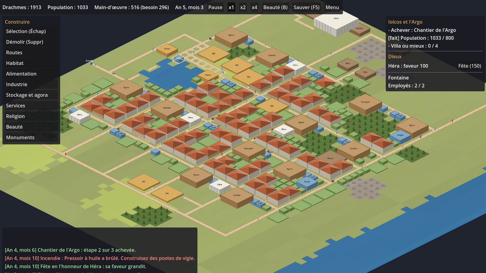

# Ktisis

City builder sur la Grèce mythologique, dans l'esprit du *Maître de l'Olympe*, avec un contenu 100 % original.
Moteur : Godot 4.6 (GDScript), 2D isométrique, PC.



La note de conception vit dans le coffre SecondBrain (`Projects/Ktisis.md`).

## Lancer le jeu

### Prérequis

- **Godot 4.6.1**, version standard (pas la version .NET) : <https://godotengine.org/download/archive/4.6.1-stable/>. Godot est un seul exécutable, sans installation. Le projet est testé en 4.6.1 ; une version plus ancienne ne l'ouvrira pas correctement.
- **Git**, pour récupérer le dépôt.
- Pour que les commandes ci-dessous marchent telles quelles, l'exécutable doit être accessible sous le nom `godot` (par exemple un lien `godot` dans le `PATH`). Sinon, remplacer `godot` par son chemin complet, par exemple `"C:\Godot\Godot_v4.6.1-stable_win64.exe"` sous Windows ou `/Applications/Godot.app/Contents/MacOS/Godot` sous macOS.

### Installation

```
git clone https://github.com/thoKling/Ktisis.git
cd Ktisis
godot --headless --editor --quit --path .   # import des images et polices (première fois, puis après chaque nouvel asset)
```

L'import crée le dossier `.godot/` (ignoré par Git). Sans lui, le jeu se lance sans ses textures. Ouvrir le projet une fois dans l'éditeur fait la même chose.

### Lancement

```
godot --path .
```

Ou, avec l'éditeur : lancer Godot, « Importer », choisir `project.godot`, puis F5 pour jouer.

## Commandes

| Action | Commande |
|---|---|
| Déplacer la caméra | ZQSD/WASD, flèches, clic molette maintenu |
| Zoom | molette |
| Construire | menu de gauche, puis clic (routes, maisons et jardins : glisser) |
| Annuler l'outil | clic droit ou Échap |
| Démolir | Suppr, puis glisser une zone |
| Vitesse | Espace (pause), 1, 2, 3 |
| Calque de beauté | B |
| Sauvegarder | F5 (puis « Reprendre » dans le menu) |

## Tests

```
godot --headless --path . -s res://tests/run.gd                 # tests du domaine puis du contenu
godot --headless --path . -s res://tests/run.gd -- domain       # seulement le domaine (quelques secondes)
godot --headless --path . -s res://tests/run.gd -- domain grid  # seulement les suites dont le nom contient « grid »
godot --headless --path . -s res://tests/presentation/smoke.gd  # scène principale et clics simulés
godot --headless --path . -s res://tests/tools/balance.gd -- 2 120   # suivi détaillé d'une mission (0 à 2)
godot --headless --path . -s res://tests/tools/balance.gd -- 1 60 poseidon   # Athènes, avec Poséidon pour protecteur
xvfb-run godot --path . -s res://tests/tools/screenshot.gd -- capture.png 12   # capture d'écran
```

Les tests tournent aussi dans GitHub Actions. Dans les sessions cloud de Claude Code, Godot est installé par `.claude/hooks/session-start.sh`.

## Organisation

- `data/` : bâtiments, ressources, dieux et missions en JSON. On équilibre ici, sans toucher au code.
- `src/domain/` : le jeu lui-même, en GDScript pur, sans nœud, sans fichier, sans affichage.
  - `city.gd` : la cité (état du monde) ; elle avance par pas fixes et expose commandes et requêtes.
  - `rules.gd` : constantes de règles (durées, rayons, seuils).
  - `catalog.gd` : définitions du jeu, construites à partir de dictionnaires.
  - `world/` : grille (terrain, routes, chemins), bâtiments, marcheurs, générateur de cartes.
  - `systems/` : une règle par fichier (construction, habitat, logistique, services, beauté, travail, incendies, religion, monuments, objectifs), fonctions sans état qui agissent sur la cité.
  - `save_codec.gd` : cité vers dictionnaire et retour.
- `src/infrastructure/` : ce qui touche aux fichiers (lecture de `data/`, sauvegarde et progression dans `user://`).
- `src/presentation/` : nœuds Godot, rendu isométrique, interface et textes affichés. Seule couche à connaître les deux autres.
- `tests/` : `domain/` (tests unitaires, avec des données écrites à la main dans `lib/fixtures.gd`), `content/` (les vraies données et l'équilibrage de la campagne), `presentation/` (smoke test), `tools/` (planificateur, suivi d'équilibrage, captures).
- `assets/` : sprites optionnels, voir `assets/README.md`.
